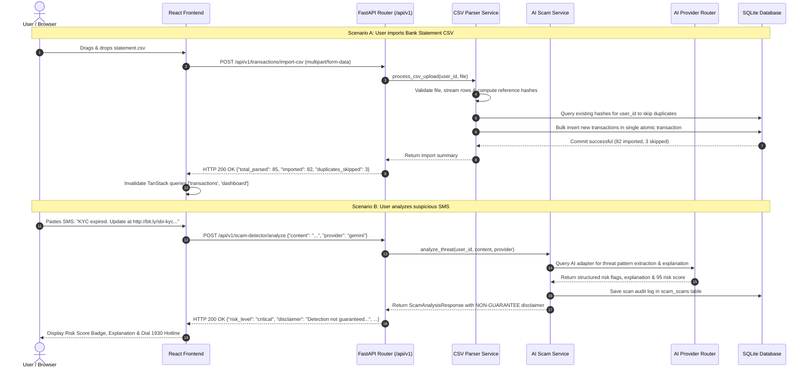

# CashNiti — System Architecture

## 1. Architectural Overview & System Design

CashNiti is designed as a decoupled, multi-tiered application engineered for high deterministic reliability, responsiveness, clean maintainability, **strict multi-tenant data isolation**, **precision-safe currency handling**, and a **modular, multi-provider AI architecture**. The system cleanly separates the **Presentation Layer (React + Vite + Tailwind CSS)**, the **API & Orchestration Layer (FastAPI)**, the **Security & Identity Layer (JWT Authentication)**, the **Deterministic Financial Engine (Python Decimal Math)**, the **Persistence Layer (SQLite via SQLAlchemy)**, and the **Pluggable AI Subsystem (Google Gemini, Groq, OpenRouter)**.

### High-Level System Architecture Diagram

```mermaid
flowchart TB
    subgraph Client["Frontend Client (React 19 + Vite + Tailwind CSS)"]
        UI["Google Stitch Integrated UI (9 Feature Modules)"]
        FormatUtil["Currency Formatter (Standard Decimals: ₹1,000.50)"]
        AuthContext["Auth Context (JWT Token & Session)"]
        AIContext["AI Provider Selector Context"]
        ToastContext["Toast Context (UI Alerts)"]
        TanStack["TanStack Query (Server Cache, Fetching & Invalidation)"]
        Charts["Visualization Layer (Recharts)"]
        UI --> FormatUtil
        UI --> AuthContext
        UI --> AIContext
        UI --> ToastContext
        UI --> TanStack
        UI --> Charts
    end

    subgraph Gateway["FastAPI Application Boundary (backend/main.py)"]
        CORS["CORS Middleware"]
        AuthGuard["Auth Dependency (get_current_active_user)"]
        Router["API Router (/api/v1)"]
        Validation["Pydantic v2 Validation (Standard Decimal Contracts)"]
        ErrorHandler["Global Exception Handlers"]
        CORS --> Router
        Router --> AuthGuard
        AuthGuard --> Validation
        Validation --> ErrorHandler
    end

    subgraph CoreServices["Backend Core & Domain Services (User-Scoped)"]
        AuthSvc["Authentication Service (Register / Login / JWT)"]
        DashboardSvc["Dashboard Service (Scoped to user_id)"]
        TxSvc["Transaction Service (Scoped to user_id)"]
        CSVSvc["Backend CSV Ingestion & Parsing Service"]
        ExpenseSvc["Expense Intelligence Service (Scoped to user_id)"]
        ForecastSvc["Cash Flow Forecast Service (Scoped to user_id)"]
        ResilienceSvc["Resilience Planner Service (Scoped to user_id)"]
        StSSvc["Safe-to-Spend Service (Scoped to user_id)"]
        LoanSvc["Loans & EMI Service (Scoped to user_id)"]
        ScamSvc["AI Scam Detector Service (Risk Analysis & Explanation)"]
        AISvc["AI Orchestration Service (Multi-Provider Router)"]
    end

    subgraph MathEngine["Deterministic Calculation Engine (Pure Python Decimal)"]
        EMICalc["Loan Amortization & DTI Engine"]
        StSCalc["Safe-to-Spend Math Engine"]
        RunwayCalc["Resilience & Runway Engine"]
        ForecastCalc["Daily Burn & Trajectory Engine"]
        CurrencyRegistry["Currency Registry & Subunit Converters"]
    end

    subgraph AIAdapters["Modular AI Adapter Tier (Centrally Managed Keys)"]
        BaseAdapter["BaseAIProvider (Interface)"]
        GeminiAdapter["GeminiProvider (Google Gemini API)"]
        GroqAdapter["GroqProvider (Groq Cloud API)"]
        OpenRouterAdapter["OpenRouterProvider (OpenRouter Gateway)"]
        BaseAdapter --- GeminiAdapter
        BaseAdapter --- GroqAdapter
        BaseAdapter --- OpenRouterAdapter
    end

    subgraph Persistence["Persistence Layer"]
        ORM["SQLAlchemy ORM Repositories (Strict user_id Filters)"]
        SQLite[("SQLite Database (64-bit Integer Subunits: Paise)")]
    end

    %% Connections
    TanStack <-->|HTTP / REST (Standard Decimals & Bearer JWT)| Gateway
    Router --> AuthSvc
    Router --> CoreServices
    TxSvc --> CSVSvc
    CoreServices --> MathEngine
    CoreServices --> ORM
    ORM <--> SQLite
    AISvc --> BaseAdapter
    ScamSvc --> BaseAdapter
    AISvc -.->|Reads Verified Math Snapshots| MathEngine
```

---

## 2. Layered Backend Architecture

```
backend/
├── main.py                  # Server bootstrap, middleware & lifespan events
├── app/
│   ├── core/                # Configuration, security, constants, exceptions
│   │   ├── config.py        # Pydantic BaseSettings (.env loading)
│   │   ├── exceptions.py    # Custom domain exceptions
│   │   ├── security.py      # Password hashing (bcrypt/Argon2), JWT token handling
│   │   └── currency.py      # Currency Registry, scale definitions & subunit converters
│   ├── api/                 # API Routers (HTTP Layer)
│   │   ├── deps.py          # get_current_user, get_db dependency injection
│   │   ├── v1/
│   │   │   ├── api.py       # Aggregated v1 API router
│   │   │   ├── auth.py      # Registration, Login, Token Refresh, Me
│   │   │   ├── dashboard.py # User-scoped dashboard endpoints
│   │   │   ├── transactions.py # User-scoped transaction & CSV endpoints
│   │   │   ├── expenses.py  # User-scoped expense analytics & budgets
│   │   │   ├── forecast.py  # User-scoped cash flow projections
│   │   │   ├── resilience.py # User-scoped emergency fund & runway
│   │   │   ├── safe_to_spend.py # User-scoped safe-to-spend calculation
│   │   │   ├── loans.py     # User-scoped loan tracking & amortization
│   │   │   ├── ai.py        # Multi-provider AI assistant endpoints & provider list
│   │   │   └── scam_detector.py # AI-based scam detection & risk explanation
│   ├── schemas/             # Pydantic v2 Models (Standard Decimal DTOs)
│   │   ├── user.py
│   │   ├── transaction.py   # TransactionCreate, TransactionResponse, CSVImportResult
│   │   ├── forecast.py
│   │   ├── loan.py
│   │   ├── safe_to_spend.py
│   │   ├── ai.py            # AIProviderInfo, AIChatRequest, AIChatResponse
│   │   └── scam.py          # ScamAnalysisRequest, ScamAnalysisResponse
│   ├── services/            # Business & Orchestration Layer (All methods take user_id)
│   │   ├── auth_service.py
│   │   ├── transaction_service.py
│   │   ├── csv_parser_service.py # Backend CSV validation, parsing & duplicate checking
│   │   ├── ai_service.py    # AI provider selection, prompt grounding & fallback
│   │   └── scam_detector_service.py # AI threat analysis & non-guaranteed risk scoring
│   ├── ai/                  # Modular AI Provider Adapters
│   │   ├── base.py          # BaseAIProvider abstract interface
│   │   ├── gemini.py        # Google Gemini implementation
│   │   ├── groq.py          # Groq Cloud implementation
│   │   └── openrouter.py    # OpenRouter gateway implementation
│   ├── calculations/        # Pure Deterministic Mathematical Engines (Python Decimal)
│   │   ├── emi.py           # Reducing-balance EMI & prepayment
│   │   ├── safe_to_spend.py # StS formulas & buffer deduction
│   │   ├── runway.py        # Emergency runway & survival metrics
│   │   └── forecast.py      # Daily trajectory projections
│   ├── models/              # SQLAlchemy ORM Models (Subunit Integers)
│   │   ├── base.py
│   │   ├── user.py
│   │   ├── transaction.py
│   │   ├── loan.py
│   │   └── obligation.py
│   └── db/                  # Database connectivity & session management
│       ├── session.py       # engine, SessionLocal, get_db dependency
│       └── init_db.py       # Seed initial global system categories
```

---

## 3. Finalised Architectural Decisions & Subsystems

### 3.1 Multi-User Architecture & Strict Data Isolation (Decision 1)
- Individual user accounts authenticated via signed JWT Bearer tokens.
- Every financial entity is owned by `user_id INTEGER NOT NULL REFERENCES users(id) ON DELETE CASCADE`.
- The FastAPI dependency `get_current_active_user` enforces `WHERE user_id = :current_user_id` across all queries.
- Requests for records belonging to another user return `404 Not Found` to prevent account enumeration.

### 3.2 Monetary Precision, Currency Decoupling & Multi-Currency Readiness (Decision 2)
- **Default Currency:** INR (₹).
- **UI Abstraction:** The user interface displays and accepts standard currency formats (e.g., `₹1,000.50`). Raw Paise values are strictly hidden from users.
- **Subunit Storage:** Amounts stored as 64-bit signed integers in currency subunits (Paise for INR, 1 INR = 100 Paise) in SQLite to eliminate floating-point drift.
- **Calculation Core:** Pure Python `decimal.Decimal` with explicit rounding.
- **Separation of Concerns:** Formatting, currency metadata, and storage are decoupled for future multi-currency support.

### 3.3 Multi-Provider AI Architecture (Decision 3)
- Modular adapter pattern (`BaseAIProvider`) supporting Google Gemini, Groq, and OpenRouter.
- Users choose their preferred AI provider in the UI.
- Central backend key management; users never provide their own API keys.
- Free-tier prioritization with zero silent paid escalation and transparent limit tracking (`GET /api/v1/ai/providers`).
- Strict deterministic independence: core financial calculations never depend on AI availability.

### 3.4 Stitch UI Integration & Frontend Architecture (Decision 4)
- Authoritative visual foundation is the Google Stitch export at `frontend/stitch-export/`.
- Nine reusable React feature modules inside `frontend/src/modules/` preserving the "Lavender Minimalist FinTech" design system.
- Shared persistent shell (`AppLayout`, `Sidebar`, `TopNav`) and atomic UI components extracted from Stitch markup.
- Static SVG placeholders replaced with dynamic Recharts components.

### 3.5 Frontend State Management Architecture (Decision 5 - Finalised)
- **Server State:** **TanStack React Query** manages all backend API data fetching, asynchronous caching, background synchronization, and automatic cache invalidation upon ledger updates.
- **Shared UI State:** **React Context** manages client-only, application-wide state:
  - `AuthContext`: Authenticated user profile, token persistence, and sign-in/sign-out handlers.
  - `AIProviderContext`: Current user-selected AI provider preference.
  - `ToastContext`: Global notification banner queue.
- **Component State:** Standard React `useState`/`useReducer` for isolated local UI state (modals, dropdowns, form inputs).

### 3.6 Backend CSV Statement Processing Pipeline (Decision 6 - Finalised)
All CSV statement ingestion is handled exclusively on the **Python FastAPI backend**:
```
User selects CSV -> Multipart Upload -> FastAPI /api/v1/transactions/import-csv
  ├── 1. File validation (size limit, mime-type, encoding detection)
  ├── 2. Streaming parser (HDFC, SBI, ICICI, Axis & generic formats)
  ├── 3. Row sanitization (ISO date parsing, amount to Decimal, credit/debit classification)
  ├── 4. User-scoped duplicate checking (hash: SHA-256(date + amount + description))
  ├── 5. Category auto-tagging heuristics (merchant keyword matching)
  ├── 6. Atomic DB write (SQLAlchemy session commit; rollback on error)
  └── 7. Invalidation trigger -> Frontend TanStack Query refreshes ledger & dashboard
```

### 3.7 AI-Based Scam Detection Architecture (Decision 7 - Finalised)
- **AI-Powered Threat Analysis:** Scam detection uses AI models to analyze suspicious messages, payment requests, SMS alerts, and links.
- **Risk Analysis & Plain-English Explanation:** The AI evaluates social engineering red flags (fake bank domain lookalikes, urgency pressure, APK download links, deceptive UPI collect requests) and produces clear explanations of potential risks.
- **Strict Non-Guarantee Disclaimer:** The architecture explicitly incorporates prominent disclaimers across API payloads and UI views:
  > **Notice:** AI scam detection is an educational and advisory tool. Detection is **NOT guaranteed**. Users must remain vigilant and report incidents directly to the National Cyber Crime portal (**1930** / **cybercrime.gov.in**).

---

## 4. End-to-End CSV Processing and AI Scam Analysis Flows



---

## 5. Security, Privacy & Data Protection

1. **Multi-Tenant Data Sovereignty:** Every financial row is tied to `user_id` with foreign key constraints and composite indexes. Cross-tenant reads or updates are impossible.
2. **Centralized Key Protection:** External AI provider keys (`GEMINI_API_KEY`, `GROQ_API_KEY`, `OPENROUTER_API_KEY`) reside exclusively in backend environment variables. Keys are never transmitted to client browsers.
3. **Password Security:** Salted `bcrypt` hashing with work factor $\ge 12$. Plaintext passwords are never logged or stored.
4. **AI Anonymization Pipeline:** Prompts dispatched to external LLMs pass through an anonymization sanitizer, replacing real names with tokens and stripping PII (bank accounts, phone numbers) before sending aggregated metrics.
5. **Input Sanitization & Precision Guards:** Pydantic v2 schemas validate input bounds, sanitizing text and parsing decimal values safely before database translation.

---

## 6. Environment Configuration

Managed using Pydantic `BaseSettings` reading from `.env`:

| Variable | Type | Default | Description |
|---|---|---|---|
| `ENVIRONMENT` | string | `development` | Runtime environment (`development`, `production`, `test`) |
| `DATABASE_URL` | string | `sqlite:///./cashniti.db` | SQLAlchemy connection string |
| `DEFAULT_CURRENCY` | string | `INR` | Default platform currency code |
| `CORS_ORIGINS` | list | `["http://localhost:5173"]` | Allowed CORS origins for Vite frontend |
| `JWT_SECRET_KEY` | string | `""` | Cryptographic secret key for signing JWT tokens |
| `JWT_ALGORITHM` | string | `HS256` | JWT signing algorithm |
| `ACCESS_TOKEN_EXPIRE_MINUTES` | integer | `60` | JWT access token lifespan in minutes |
| `DEFAULT_AI_PROVIDER` | string | `gemini` | Default backend AI provider (`gemini`, `groq`, `openrouter`) |
| `GEMINI_API_KEY` | string | `""` | Google Gemini API key (Centrally managed) |
| `GROQ_API_KEY` | string | `""` | Groq Cloud API key (Centrally managed) |
| `OPENROUTER_API_KEY` | string | `""` | OpenRouter API key (Centrally managed) |
| `LOG_LEVEL` | string | `INFO` | Application logging verbosity |
