# CashNiti — Database Design & Data Architecture

## 1. Database Selection & Strategy

### 1.1 Choice of SQLite with Multi-Tenant Architecture
CashNiti selects **SQLite** as its persistence engine, structured from the ground up with **strict user ownership and multi-tenant data isolation**:
1. **Local & Portable Multi-User Storage:** Runs embedded within the application without requiring an external database daemon, perfectly suited for privacy-conscious personal finance.
2. **ACID Transactional Integrity:** Guarantees atomic transaction writes, critical for financial ledgers, balance recalculations, and multi-row CSV imports.
3. **Strict Data Isolation from Day One:** Every table is designed with mandatory user ownership. No financial record exists without an associated user account.
4. **Seamless Cloud Migration Path:** Implemented using **SQLAlchemy ORM** and **Alembic**, ensuring that migrating from SQLite to PostgreSQL in a hosted multi-user cloud environment requires zero application code or schema redesign.

### 1.2 Monetary Precision, Currency Decoupling & Multi-Currency Readiness

The database storage strategy strictly adheres to the finalized monetary precision standard:

1. **Integer Subunits Storage Standard:** All monetary amounts are stored internally as **64-bit Signed Integers (`BIGINT` / `INTEGER`)** in currency minor subunits.
   - For **INR (₹)** (the default platform currency), amounts are stored in **Paise** ($1\text{ INR} = 100\text{ Paise}$).
   - Example: ₹1,000.50 is stored as `100050`.
   - Example: ₹25,00,000 (25 Lakhs) is stored as `250000000`.
   - Floating-point representations (`FLOAT`, `REAL`) are strictly forbidden to eliminate binary precision drift.
2. **Separation of Concerns:**
   - **Database:** Stores raw integer subunits (`amount_subunits BIGINT`) and currency identifier.
   - **API / Logic Layer:** Handles domain calculations and validations in Python `decimal.Decimal`, translating between subunits and standard currency amounts.
   - **Frontend UI:** Receives and sends standard decimal values (e.g. `1000.50`), formatting them with currency symbols (e.g. `₹1,000.50`). The UI **never** sees or exposes raw Paise.
3. **Multi-Currency Extensibility:**
   - The user profile table (`financial_profiles`) includes a `currency` column (defaulting to `'INR'`).
   - The system is architected so additional currencies (e.g., USD, EUR, GBP, JPY, AED) can be supported in the future by configuring currency metadata (scale factor and subunit divisor: 100 for INR/USD/EUR, 1 for JPY, 1000 for BHD) without modifying existing table columns or calculation contracts.

---

## 2. Entity-Relationship (ER) Diagram

```mermaid
erDiagram
    USERS ||--|| FINANCIAL_PROFILES : owns
    USERS ||--o{ CATEGORIES : creates_custom
    USERS ||--o{ TRANSACTIONS : owns
    USERS ||--o{ RECURRING_OBLIGATIONS : owns
    USERS ||--o{ BUDGETS : owns
    USERS ||--o{ FINANCIAL_GOALS : owns
    USERS ||--|| EMERGENCY_FUNDS : owns
    USERS ||--o{ LOANS : owns
    USERS ||--o{ SCAM_SCANS : owns
    USERS ||--o{ AI_CONVERSATIONS : owns

    CATEGORIES ||--o{ TRANSACTIONS : classifies
    CATEGORIES ||--o{ BUDGETS : limits
    CATEGORIES ||--o{ RECURRING_OBLIGATIONS : categorizes

    LOANS ||--o{ LOAN_AMORTIZATION_ENTRIES : contains
    AI_CONVERSATIONS ||--o{ AI_MESSAGES : contains

    USERS {
        int id PK
        string email UK
        string full_name
        string hashed_password
        boolean is_active
        datetime created_at
        datetime updated_at
    }

    FINANCIAL_PROFILES {
        int id PK
        int user_id FK,UK
        string currency "default 'INR'"
        int monthly_income_subunits
        int primary_income_date
        int default_buffer_subunits
        string risk_tolerance
        datetime created_at
        datetime updated_at
    }

    CATEGORIES {
        int id PK
        int user_id FK "NULL for global system categories"
        string name
        string type "income or expense"
        string icon
        string color
        boolean is_system
        boolean is_essential
    }

    TRANSACTIONS {
        int id PK
        int user_id FK
        int category_id FK
        int amount_subunits "Paise for INR"
        string currency "default 'INR'"
        string type "income or expense"
        date transaction_date
        string description
        string merchant
        string payment_mode "upi, card, netbanking, cash"
        boolean is_recurring
        string source "manual or csv"
        string reference_hash "user-scoped duplicate check"
        datetime created_at
        datetime updated_at
    }

    RECURRING_OBLIGATIONS {
        int id PK
        int user_id FK
        int category_id FK
        string title
        int amount_subunits "Paise for INR"
        string currency "default 'INR'"
        string frequency "monthly, quarterly, annual"
        int due_day_of_month
        date next_due_date
        boolean is_active
        datetime created_at
    }

    BUDGETS {
        int id PK
        int user_id FK
        int category_id FK
        int limit_amount_subunits "Paise for INR"
        string currency "default 'INR'"
        int month
        int year
        int alert_threshold_percentage
        datetime created_at
    }

    FINANCIAL_GOALS {
        int id PK
        int user_id FK
        string title
        int target_amount_subunits "Paise for INR"
        int current_amount_subunits "Paise for INR"
        string currency "default 'INR'"
        date target_date
        string priority "high, medium, low"
        boolean is_completed
        datetime created_at
    }

    EMERGENCY_FUNDS {
        int id PK
        int user_id FK,UK
        int target_amount_subunits "Paise for INR"
        int current_savings_subunits "Paise for INR"
        int monthly_contribution_subunits "Paise for INR"
        string currency "default 'INR'"
        int target_months
        datetime updated_at
    }

    LOANS {
        int id PK
        int user_id FK
        string loan_name
        string lender
        int principal_amount_subunits "Paise for INR"
        string currency "default 'INR'"
        numeric annual_interest_rate
        int tenure_months
        date start_date
        int monthly_emi_subunits "Paise for INR"
        int remaining_principal_subunits "Paise for INR"
        string loan_type "home, personal, car, education, other"
        boolean is_active
        datetime created_at
    }

    LOAN_AMORTIZATION_ENTRIES {
        int id PK
        int loan_id FK
        int month_number
        date due_date
        int emi_amount_subunits "Paise for INR"
        int principal_component_subunits "Paise for INR"
        int interest_component_subunits "Paise for INR"
        int remaining_balance_subunits "Paise for INR"
        string status "paid or pending"
    }

    SCAM_SCANS {
        int id PK
        int user_id FK
        string input_type "sms, email, url, upi, text"
        text content_snippet
        int risk_score
        string risk_level "low, medium, high, critical"
        json detected_flags
        json recommendations
        datetime created_at
    }

    AI_CONVERSATIONS {
        int id PK
        int user_id FK
        string session_id UK
        string title
        datetime created_at
        datetime updated_at
    }

    AI_MESSAGES {
        int id PK
        int conversation_id FK
        string role "user, assistant, system"
        text content
        json context_snapshot
        datetime created_at
    }
```



---

## 3. Schema Definitions, Constraints & Indexing

### 3.1 Table: `users`
Represents the individual user account for registration and authentication.
```sql
CREATE TABLE users (
    id INTEGER PRIMARY KEY AUTOINCREMENT,
    email VARCHAR(255) UNIQUE NOT NULL,
    full_name VARCHAR(150) NOT NULL,
    hashed_password VARCHAR(255) NOT NULL,
    is_active BOOLEAN NOT NULL DEFAULT 1,
    created_at TIMESTAMP NOT NULL DEFAULT CURRENT_TIMESTAMP,
    updated_at TIMESTAMP NOT NULL DEFAULT CURRENT_TIMESTAMP
);
CREATE UNIQUE INDEX uq_users_email ON users(email);
```

### 3.2 Table: `financial_profiles`
Contains user-specific macroeconomic parameters for calculations. Exactly one profile per user.
```sql
CREATE TABLE financial_profiles (
    id INTEGER PRIMARY KEY AUTOINCREMENT,
    user_id INTEGER NOT NULL UNIQUE,
    currency VARCHAR(10) NOT NULL DEFAULT 'INR',
    monthly_income_subunits BIGINT NOT NULL DEFAULT 0,
    primary_income_date INTEGER NOT NULL DEFAULT 1 CHECK (primary_income_date BETWEEN 1 AND 31),
    default_buffer_subunits BIGINT NOT NULL DEFAULT 500000, -- Default ₹5,000 (500000 paise)
    risk_tolerance VARCHAR(20) NOT NULL DEFAULT 'moderate',
    created_at TIMESTAMP NOT NULL DEFAULT CURRENT_TIMESTAMP,
    updated_at TIMESTAMP NOT NULL DEFAULT CURRENT_TIMESTAMP,
    FOREIGN KEY (user_id) REFERENCES users(id) ON DELETE CASCADE
);
CREATE UNIQUE INDEX uq_profile_user ON financial_profiles(user_id);
```

### 3.3 Table: `categories`
Defines transaction classification taxonomy. Supports global system categories (`user_id IS NULL`) and user-specific custom categories (`user_id = :current_user_id`).
```sql
CREATE TABLE categories (
    id INTEGER PRIMARY KEY AUTOINCREMENT,
    user_id INTEGER NULL, -- NULL indicates global system category available to all
    name VARCHAR(80) NOT NULL,
    type VARCHAR(10) NOT NULL CHECK (type IN ('income', 'expense')),
    icon VARCHAR(50) NOT NULL DEFAULT 'Tag',
    color VARCHAR(20) NOT NULL DEFAULT '#64748B',
    is_system BOOLEAN NOT NULL DEFAULT 0,
    is_essential BOOLEAN NOT NULL DEFAULT 0, -- Used for Needs vs Wants & Emergency Burn
    FOREIGN KEY (user_id) REFERENCES users(id) ON DELETE CASCADE
);
CREATE INDEX idx_categories_user ON categories(user_id);
```

### 3.4 Table: `transactions`
The immutable financial ledger strictly scoped to the owning user.
```sql
CREATE TABLE transactions (
    id INTEGER PRIMARY KEY AUTOINCREMENT,
    user_id INTEGER NOT NULL,
    category_id INTEGER NOT NULL,
    amount_subunits BIGINT NOT NULL CHECK (amount_subunits > 0), -- Stored in paise for INR
    currency VARCHAR(10) NOT NULL DEFAULT 'INR',
    type VARCHAR(10) NOT NULL CHECK (type IN ('income', 'expense')),
    transaction_date DATE NOT NULL,
    description VARCHAR(255) NOT NULL,
    merchant VARCHAR(120) NULL,
    payment_mode VARCHAR(20) NOT NULL DEFAULT 'upi' CHECK (payment_mode IN ('upi', 'card', 'netbanking', 'cash', 'other')),
    is_recurring BOOLEAN NOT NULL DEFAULT 0,
    source VARCHAR(20) NOT NULL DEFAULT 'manual' CHECK (source IN ('manual', 'csv')),
    reference_hash VARCHAR(64) NULL, -- SHA256(date + amount + description) scoped to user
    created_at TIMESTAMP NOT NULL DEFAULT CURRENT_TIMESTAMP,
    updated_at TIMESTAMP NOT NULL DEFAULT CURRENT_TIMESTAMP,
    FOREIGN KEY (user_id) REFERENCES users(id) ON DELETE CASCADE,
    FOREIGN KEY (category_id) REFERENCES categories(id) ON DELETE RESTRICT
);
CREATE INDEX idx_tx_user_date ON transactions(user_id, transaction_date DESC);
CREATE INDEX idx_tx_user_category ON transactions(user_id, category_id);
CREATE UNIQUE INDEX uq_tx_user_ref_hash ON transactions(user_id, reference_hash) WHERE reference_hash IS NOT NULL;
```

### 3.5 Table: `recurring_obligations`
Known recurring bills and fixed commitments scoped to the user.
```sql
CREATE TABLE recurring_obligations (
    id INTEGER PRIMARY KEY AUTOINCREMENT,
    user_id INTEGER NOT NULL,
    category_id INTEGER NOT NULL,
    title VARCHAR(120) NOT NULL,
    amount_subunits BIGINT NOT NULL CHECK (amount_subunits > 0), -- Stored in paise for INR
    currency VARCHAR(10) NOT NULL DEFAULT 'INR',
    frequency VARCHAR(20) NOT NULL DEFAULT 'monthly' CHECK (frequency IN ('weekly', 'monthly', 'quarterly', 'annual')),
    due_day_of_month INTEGER NOT NULL CHECK (due_day_of_month BETWEEN 1 AND 31),
    next_due_date DATE NOT NULL,
    is_active BOOLEAN NOT NULL DEFAULT 1,
    created_at TIMESTAMP NOT NULL DEFAULT CURRENT_TIMESTAMP,
    FOREIGN KEY (user_id) REFERENCES users(id) ON DELETE CASCADE,
    FOREIGN KEY (category_id) REFERENCES categories(id) ON DELETE RESTRICT
);
CREATE INDEX idx_recurring_user ON recurring_obligations(user_id, is_active);
```

### 3.6 Table: `budgets`
Monthly category-level spend ceilings per user.
```sql
CREATE TABLE budgets (
    id INTEGER PRIMARY KEY AUTOINCREMENT,
    user_id INTEGER NOT NULL,
    category_id INTEGER NOT NULL,
    limit_amount_subunits BIGINT NOT NULL CHECK (limit_amount_subunits > 0), -- Stored in paise for INR
    currency VARCHAR(10) NOT NULL DEFAULT 'INR',
    month INTEGER NOT NULL CHECK (month BETWEEN 1 AND 12),
    year INTEGER NOT NULL CHECK (year >= 2020),
    alert_threshold_percentage INTEGER NOT NULL DEFAULT 85 CHECK (alert_threshold_percentage BETWEEN 1 AND 100),
    created_at TIMESTAMP NOT NULL DEFAULT CURRENT_TIMESTAMP,
    FOREIGN KEY (user_id) REFERENCES users(id) ON DELETE CASCADE,
    FOREIGN KEY (category_id) REFERENCES categories(id) ON DELETE CASCADE,
    CONSTRAINT uq_user_cat_month_year UNIQUE (user_id, category_id, month, year)
);
CREATE INDEX idx_budgets_user_period ON budgets(user_id, year, month);
```

### 3.7 Table: `financial_goals`
User target milestones (e.g., Vacation, Laptop, Wedding Fund).
```sql
CREATE TABLE financial_goals (
    id INTEGER PRIMARY KEY AUTOINCREMENT,
    user_id INTEGER NOT NULL,
    title VARCHAR(120) NOT NULL,
    target_amount_subunits BIGINT NOT NULL CHECK (target_amount_subunits > 0),
    current_amount_subunits BIGINT NOT NULL DEFAULT 0 CHECK (current_amount_subunits >= 0),
    currency VARCHAR(10) NOT NULL DEFAULT 'INR',
    target_date DATE NOT NULL,
    priority VARCHAR(10) NOT NULL DEFAULT 'medium' CHECK (priority IN ('low', 'medium', 'high')),
    is_completed BOOLEAN NOT NULL DEFAULT 0,
    created_at TIMESTAMP NOT NULL DEFAULT CURRENT_TIMESTAMP,
    FOREIGN KEY (user_id) REFERENCES users(id) ON DELETE CASCADE
);
CREATE INDEX idx_goals_user ON financial_goals(user_id, is_completed);
```

### 3.8 Table: `emergency_funds`
Target and accumulated liquid reserves for personal resilience per user.
```sql
CREATE TABLE emergency_funds (
    id INTEGER PRIMARY KEY AUTOINCREMENT,
    user_id INTEGER NOT NULL UNIQUE,
    target_amount_subunits BIGINT NOT NULL DEFAULT 0,
    current_savings_subunits BIGINT NOT NULL DEFAULT 0,
    monthly_contribution_subunits BIGINT NOT NULL DEFAULT 0,
    currency VARCHAR(10) NOT NULL DEFAULT 'INR',
    target_months INTEGER NOT NULL DEFAULT 6 CHECK (target_months BETWEEN 1 AND 24),
    updated_at TIMESTAMP NOT NULL DEFAULT CURRENT_TIMESTAMP,
    FOREIGN KEY (user_id) REFERENCES users(id) ON DELETE CASCADE
);
CREATE UNIQUE INDEX uq_emergency_user ON emergency_funds(user_id);
```

### 3.9 Table: `loans` and `loan_amortization_entries`
Tracks consumer loans, personal loans, and auto/home loans per user.
```sql
CREATE TABLE loans (
    id INTEGER PRIMARY KEY AUTOINCREMENT,
    user_id INTEGER NOT NULL,
    loan_name VARCHAR(120) NOT NULL,
    lender VARCHAR(120) NOT NULL,
    principal_amount_subunits BIGINT NOT NULL CHECK (principal_amount_subunits > 0),
    currency VARCHAR(10) NOT NULL DEFAULT 'INR',
    annual_interest_rate NUMERIC(5, 2) NOT NULL CHECK (annual_interest_rate >= 0),
    tenure_months INTEGER NOT NULL CHECK (tenure_months > 0),
    start_date DATE NOT NULL,
    monthly_emi_subunits BIGINT NOT NULL CHECK (monthly_emi_subunits > 0),
    remaining_principal_subunits BIGINT NOT NULL,
    loan_type VARCHAR(30) NOT NULL DEFAULT 'personal' CHECK (loan_type IN ('personal', 'home', 'car', 'education', 'consumer_emi', 'other')),
    is_active BOOLEAN NOT NULL DEFAULT 1,
    created_at TIMESTAMP NOT NULL DEFAULT CURRENT_TIMESTAMP,
    FOREIGN KEY (user_id) REFERENCES users(id) ON DELETE CASCADE
);
CREATE INDEX idx_loans_user ON loans(user_id, is_active);

CREATE TABLE loan_amortization_entries (
    id INTEGER PRIMARY KEY AUTOINCREMENT,
    loan_id INTEGER NOT NULL,
    month_number INTEGER NOT NULL,
    due_date DATE NOT NULL,
    emi_amount_subunits BIGINT NOT NULL,
    principal_component_subunits BIGINT NOT NULL,
    interest_component_subunits BIGINT NOT NULL,
    remaining_balance_subunits BIGINT NOT NULL,
    status VARCHAR(15) NOT NULL DEFAULT 'pending' CHECK (status IN ('paid', 'pending')),
    FOREIGN KEY (loan_id) REFERENCES loans(id) ON DELETE CASCADE
);
CREATE INDEX idx_amortization_loan ON loan_amortization_entries(loan_id, month_number);
```

### 3.10 Table: `scam_scans`
Audited logs of heuristic analysis on suspicious text or messages per user.
```sql
CREATE TABLE scam_scans (
    id INTEGER PRIMARY KEY AUTOINCREMENT,
    user_id INTEGER NOT NULL,
    input_type VARCHAR(20) NOT NULL CHECK (input_type IN ('sms', 'email', 'url', 'upi', 'text')),
    content_snippet TEXT NOT NULL,
    risk_score INTEGER NOT NULL CHECK (risk_score BETWEEN 0 AND 100),
    risk_level VARCHAR(15) NOT NULL CHECK (risk_level IN ('low', 'medium', 'high', 'critical')),
    detected_flags JSON NOT NULL,
    recommendations JSON NOT NULL,
    created_at TIMESTAMP NOT NULL DEFAULT CURRENT_TIMESTAMP,
    FOREIGN KEY (user_id) REFERENCES users(id) ON DELETE CASCADE
);
CREATE INDEX idx_scans_user ON scam_scans(user_id, created_at DESC);
```

### 3.11 Tables: `ai_conversations` and `ai_messages`
Stores assistant session history and grounded financial context snapshots per user.
```sql
CREATE TABLE ai_conversations (
    id INTEGER PRIMARY KEY AUTOINCREMENT,
    user_id INTEGER NOT NULL,
    session_id VARCHAR(64) UNIQUE NOT NULL,
    title VARCHAR(150) NOT NULL DEFAULT 'New Conversation',
    created_at TIMESTAMP NOT NULL DEFAULT CURRENT_TIMESTAMP,
    updated_at TIMESTAMP NOT NULL DEFAULT CURRENT_TIMESTAMP,
    FOREIGN KEY (user_id) REFERENCES users(id) ON DELETE CASCADE
);
CREATE INDEX idx_ai_conv_user ON ai_conversations(user_id);

CREATE TABLE ai_messages (
    id INTEGER PRIMARY KEY AUTOINCREMENT,
    conversation_id INTEGER NOT NULL,
    role VARCHAR(15) NOT NULL CHECK (role IN ('user', 'assistant', 'system')),
    content TEXT NOT NULL,
    context_snapshot JSON NULL,
    created_at TIMESTAMP NOT NULL DEFAULT CURRENT_TIMESTAMP,
    FOREIGN KEY (conversation_id) REFERENCES ai_conversations(id) ON DELETE CASCADE
);
CREATE INDEX idx_ai_messages_conv ON ai_messages(conversation_id, created_at ASC);
```

---

## 4. User Ownership & Multi-Tenant Data Isolation Strategy

To guarantee that **users can never view, mutate, or delete another user's financial data**:

1. **Mandatory Ownership Constraint:** Every primary entity table contains an explicit, indexed `user_id INTEGER NOT NULL` foreign key referencing `users(id)`.
2. **Strict Query Parameterization:**
   - Every read query MUST enforce:
     ```python
     db.query(Transaction).filter(Transaction.user_id == current_user.id, ...)
     ```
   - Single-record mutations enforce identity ownership:
     ```python
     record = db.query(Loan).filter(Loan.id == loan_id, Loan.user_id == current_user.id).first()
     if not record:
         raise HTTPException(status_code=404, detail="Loan not found")
     ```
   - If a record with that ID exists in the database but belongs to another user, the API responds with `404 Not Found` (rather than `403 Forbidden`) to eliminate resource enumeration vulnerabilities.
3. **User-Scoped Unique Indexes:** Duplicate detection (such as CSV transaction reference hashes) is scoped strictly per-user:
   ```sql
   CREATE UNIQUE INDEX uq_tx_user_ref_hash ON transactions(user_id, reference_hash) WHERE reference_hash IS NOT NULL;
   ```
4. **Cascading Purge:** If a user account is deleted, SQLite's foreign key engine automatically cascades and permanently purges all linked transactions, loans, budgets, goals, scans, and chat logs (`ON DELETE CASCADE`).

---

## 5. Database Migration & Seeding Plan (Alembic)

1. **Alembic Initialization:** Alembic will manage migrations inside `backend/alembic` targeting `backend/cashniti.db`.
2. **Initial Schema Migration:** Baseline migration `0001_initial_schema.py` creates all 12 tables with user ownership foreign keys, constraints, currency codes, and composite indexes.
3. **Data Seeding Script:** `backend/app/db/init_db.py` will execute idempotent seeding for **global system categories only** (`user_id = NULL`). No hardcoded mock users will be seeded; accounts are created dynamically via `/api/v1/auth/register`.
