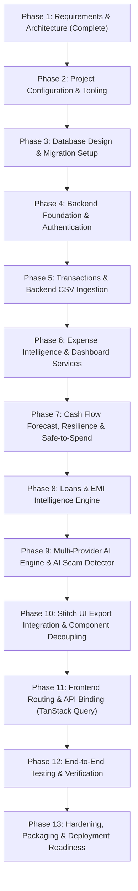

# CashNiti — Phased Development Roadmap

## 1. Roadmap Strategy & Sequencing Rationale

The development plan follows a rigorous **bottom-up, math-first, design-grounded** methodology. The sequence ensures that:
1. **The mathematical core is fully verified first:** Calculators (EMI, Safe to Spend, Runway, Cash Flow) are built as pure Python modules with 100% unit test coverage before touching the database or API.
2. **Database isolation is established from day one:** All tables enforce `user_id` foreign keys, composite indexes, and currency subunit columns (`amount_subunits BIGINT`).
3. **Backend-driven CSV processing is robust:** CSV statement validation, parsing, duplicate checking, and saving are executed entirely on the Python backend with atomic database transactions.
4. **Multi-Provider AI Subsystem is pluggable:** The AI engine implements the agreed `BaseAIProvider` adapter pattern with centralized key management (Google Gemini, Groq, OpenRouter).
5. **AI-Based Scam Detection includes explicit disclaimers:** Threat analysis and explanations are generated by AI, accompanied by mandatory non-guarantee notices.
6. **Stitch UI integration preserves 100% visual fidelity:** The inspected HTML5 + Tailwind CSS files in `frontend/stitch-export/` are decoupled cleanly into React feature modules inside `frontend/src/modules/` and connected to live APIs via **TanStack React Query** and **React Context**.

---

## 2. Detailed Implementation Phases

---

### Phase 1: Requirements & Architecture (Complete)
- **Status:** Complete.
- **Deliverables:** All 10 technical specifications, database designs, API contracts, financial math engines, Stitch integration plans, and finalized architectural decisions documented in `docs/`.

---

### Phase 2: Project Configuration & Tooling Setup
- **Tasks:**
  - Configure `backend/.env` and Pydantic `BaseSettings` (`backend/app/core/config.py`).
  - Configure Tailwind CSS in `frontend/tailwind.config.js` with tokens from `lavender_minimalist_fintech/DESIGN.md`.
  - Add Inter font and Material Symbols stylesheet links to `frontend/index.html`.
  - Install backend dependencies (`sqlalchemy`, `alembic`, `pydantic-settings`, `python-multipart`, `bcrypt`, `pyjwt`, `httpx`).
  - Install frontend dependencies (`react-router-dom`, `@tanstack/react-query`, `axios`, `recharts`, `lucide-react`).
- **Dependencies:** User approval of Phase 1.
- **Completion Criteria:** `npm run dev` and `uvicorn main:app` start cleanly without warnings.

---

### Phase 3: Database Design & Migration Setup
- **Tasks:**
  - Define SQLAlchemy ORM models matching `DATABASE_DESIGN.md` with mandatory `user_id` foreign keys and `amount_subunits` integers.
  - Configure Alembic migration environment (`backend/alembic`).
  - Generate baseline migration `0001_initial_schema.py`.
  - Implement idempotent database seed script (`backend/app/db/init_db.py`) for global system categories (user accounts are created dynamically via `/auth/register`).
- **Dependencies:** Phase 2.
- **Completion Criteria:** Migration creates all 12 tables in `backend/cashniti.db` with proper foreign keys, checks, and unique indexes.

---

### Phase 4: Backend Foundation & Authentication
- **Tasks:**
  - Set up global exception handlers and standardized API response middleware.
  - Implement User Authentication service & JWT middleware (`/api/v1/auth/register`, `/api/v1/auth/login`, and `get_current_active_user` dependency).
  - Implement pure Python currency and rounding utilities (`to_subunits`, `from_subunits`, `CURRENCY_REGISTRY`).
  - Implement pure unit-testable mathematical functions in `backend/app/calculations/`:
    - Reducing-balance loan EMI and amortization schedule.
    - Safe-to-Spend formula.
    - Emergency runway and resilience score.
    - Daily cash flow burn rate.
- **Dependencies:** Phase 3.
- **Completion Criteria:** `pytest` passes with 0 failures on all mathematical calculation and authentication suites.

---

### Phase 5: Transactions & Backend CSV Ingestion Module (Decision 6)
- **Tasks:**
  - Implement `Transaction` CRUD endpoints (`GET /api/v1/transactions`, `POST`, `PUT`, `DELETE`), strictly user-scoped.
  - Build bank statement CSV parser service in FastAPI supporting standard Indian bank exports (HDFC, SBI, ICICI, Axis) and generic formats.
  - Implement streaming row validation, Decimal amount conversion, and duplicate transaction checking using user-scoped reference hashes (`reference_hash`).
  - Implement keyword-based auto-categorization rules.
  - Ensure all parsed transactions are committed atomically within a single database transaction with automatic rollback on error.
- **Dependencies:** Phase 4.
- **Completion Criteria:** Backend CSV endpoint validates and imports statement rows atomically, rejecting duplicates and returning structured import summaries.

---

### Phase 6: Expense Intelligence & Dashboard Services
- **Tasks:**
  - Implement category-wise expense aggregation service.
  - Implement Needs vs. Wants (50/30/20) calculation service.
  - Implement Budget tracking and threshold alert system.
  - Implement aggregated Dashboard summary endpoint (`GET /api/v1/dashboard/summary`).
- **Dependencies:** Phase 5.
- **Completion Criteria:** Dashboard summary accurately reflects live user ledger data.

---

### Phase 7: Cash Flow Forecast, Resilience & Safe-to-Spend
- **Tasks:**
  - Implement Recurring Obligations management service.
  - Implement 30/60/90-day Cash Flow Forecast engine projecting daily balance trajectories.
  - Implement Financial Resilience Planner (emergency runway and stress-test simulation).
  - Implement Safe-to-Spend service with cushion buffer deduction and daily allowance.
- **Dependencies:** Phase 6.
- **Completion Criteria:** Projections correctly account for upcoming EMIs, bills, and trailing daily burn rates.

---

### Phase 8: Loans & EMI Intelligence Engine
- **Tasks:**
  - Implement Loan portfolio management endpoints (`GET /api/v1/loans`, `POST /api/v1/loans`).
  - Implement dynamic amortization schedule generator.
  - Implement Prepayment simulator (tenure reduction vs. EMI reduction).
  - Implement Debt-to-Income (DTI) ratio calculator with risk benchmarks.
- **Dependencies:** Phase 7.
- **Completion Criteria:** Prepayment simulation matches standard banking formulas down to the exact rupee.

---

### Phase 9: Multi-Provider AI Engine & AI Scam Detector (Decisions 3 & 7)
- **Tasks:**
  - Implement `BaseAIProvider` interface and adapters for Google Gemini, Groq, and OpenRouter with central backend key management.
  - Verify current free-tier terms, pricing, rate limits, and model names for all three providers.
  - Implement rate-limit tracking and transparent quota communication (`GET /api/v1/ai/providers`).
  - Implement prompt grounding pipeline injecting verified mathematical snapshots and stripping PII.
  - Implement **AI-based Scam Detector Service**:
    - AI analyzes suspicious message text, SMS, payment requests, and URLs.
    - AI produces structured threat flags, risk score, and plain-English risk explanations.
    - Payload explicitly incorporates the non-guarantee disclaimer and emergency helpline 1930.
- **Dependencies:** Phase 8.
- **Completion Criteria:** Users can choose between Gemini, Groq, and OpenRouter; AI chat outputs cite verified numbers; Scam Detector explains potential risks with prominent non-guarantee notices.

---

### Phase 10: Stitch UI Export Integration & Component Decoupling (Decision 4)
- **Tasks:**
  - Extract reusable layout shell (`AppLayout`, `Sidebar`, `TopNav`) from `frontend/stitch-export/`.
  - Extract common atomic components (`StatCard`, `Button`, `Modal`, `Badge`).
  - Modularize the 9 exported screens into `frontend/src/modules/`:
    - `dashboard/DashboardView.jsx`
    - `transactions/TransactionsView.jsx`
    - `expense-intelligence/ExpenseIntelligenceView.jsx`
    - `cash-flow/CashFlowForecastView.jsx`
    - `resilience/FinancialResilienceView.jsx`
    - `safe-to-spend/SafeToSpendView.jsx`
    - `loans/LoansView.jsx`
    - `ai-assistant/AIAssistantView.jsx`
    - `scam-detector/ScamDetectorView.jsx`
  - Replace static SVG chart mockups with dynamic Recharts components.
- **Dependencies:** Inspected Stitch export (`frontend/stitch-export/`).
- **Completion Criteria:** All 9 screens render visually in React + Vite without style breakage, preserving 100% of the Lavender theme.

---

### Phase 11: Frontend Routing & API Binding (Decision 5 - TanStack Query)
- **Tasks:**
  - Configure React Router DOM in `App.jsx` for all 9 module routes.
  - Wrap application in TanStack `QueryClientProvider` and React Context providers (`AuthContext`, `AIProviderContext`, `ToastContext`).
  - Wire each feature view to backend API services using TanStack Query custom hooks (`useDashboard`, `useTransactions`, `useSafeToSpend`, etc.).
  - Wire `CSVImportModal` to the backend multipart import endpoint with progress tracking and automatic query invalidation.
  - Wire `ScamDetectorView` to the AI threat analysis endpoint displaying the risk gauge and non-guarantee disclaimer.
- **Dependencies:** Phase 9 and Phase 10.
- **Completion Criteria:** All screens display dynamic live data from FastAPI and update reactively.

---

### Phase 12: End-to-End Testing & Verification
- **Tasks:**
  - User journey test: Register user -> import CSV -> review dashboard -> check safe-to-spend -> simulate loan prepayment -> test AI assistant on Groq & Gemini -> scan scam SMS.
  - Verify financial precision across all calculations.
  - Verify multi-tenant data isolation (User B cannot see User A's data).
- **Dependencies:** Phase 11.
- **Completion Criteria:** Zero console errors, zero math drift, 100% test pass rate.

---

### Phase 13: Hardening, Packaging & Deployment Readiness
- **Tasks:**
  - Production build optimizations (`vite build`).
  - Database indexing verification and SQLite vacuum routines.
  - Self-hosted deployment packaging and runbooks.
- **Dependencies:** Phase 12.
- **Completion Criteria:** One-command startup for end users.
