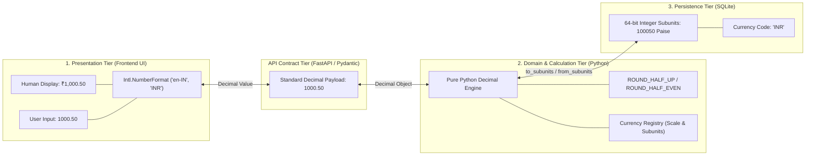

# CashNiti — Financial Logic & Precision Specifications

## 1. Monetary Precision, Currency Architecture & Separation of Concerns

### 1.1 The Golden Rules of Monetary Computation
1. **Default Currency:** Indian Rupees (**INR - ₹**) is the default platform currency.
2. **User Experience Standard:** Users must enter and view all monetary amounts in normal currency format (e.g., `₹1,000.50`, `₹45,000.00`).
3. **UI Abstraction Guarantee:** The user interface must **never** expose raw Paise values to end users.
4. **Internal Storage Standard:** All monetary figures are persisted in the database as **64-bit signed integers (`BIGINT`)** in currency subunits (Paise for INR, where $1\text{ INR} = 100\text{ Paise}$) to eliminate binary floating-point rounding errors.
5. **Calculation Engine Standard:** All domain financial calculations and conversions use Python's `decimal.Decimal` with explicit rounding modes.
6. **Separation of Concerns:** Currency formatting, currency selection, and database storage are strictly separated into independent layers.
7. **Future Multi-Currency Readiness:** The system is engineered so additional currencies can be supported in the future with currency-specific subunit precision rules without altering calculation core logic or database integrity.

---

### 1.2 The Three-Tier Architectural Separation of Concerns



#### Tier 1: Presentation & Formatting Layer (Frontend)
- Receives standard decimal numbers from the API (e.g., `1000.50`).
- Formats amounts for the user using localized formatters (`formatINR(1000.50)` produces `"₹1,000.50"`).
- Parses user text inputs into standard decimal numbers before dispatching API requests.
- **Strict Rule:** Raw subunit values (Paise) are never transmitted to, displayed by, or required from the frontend UI.

#### Tier 2: Domain Calculation Layer (Backend Python)
- All arithmetic operations (balances, EMIs, burn rates, runways, allocations) execute using Python's `decimal.Decimal`.
- Explicit rounding strategies:
  - Commercial rounding (`ROUND_HALF_UP`) for user-facing metric summaries and budget limits.
  - Financial/Bankers rounding (`ROUND_HALF_EVEN`) for periodic loan interest amortization entries.

#### Tier 3: Persistence Layer (Database)
- Database columns store amounts as 64-bit signed integers (`BIGINT`).
- The database only knows integer subunits and the associated currency code (`'INR'`).
- Conversion helpers at the repository boundary:
  ```python
  from decimal import Decimal, ROUND_HALF_UP

  CURRENCY_REGISTRY = {
      "INR": {"scale": 2, "divisor": 100, "symbol": "₹"},
      "USD": {"scale": 2, "divisor": 100, "symbol": "$"},
      "EUR": {"scale": 2, "divisor": 100, "symbol": "€"},
      "GBP": {"scale": 2, "divisor": 100, "symbol": "£"},
      "JPY": {"scale": 0, "divisor": 1, "symbol": "¥"},
      "KWD": {"scale": 3, "divisor": 1000, "symbol": "KD"},
  }

  def from_subunits(subunits: int, currency: str = "INR") -> Decimal:
      meta = CURRENCY_REGISTRY.get(currency, CURRENCY_REGISTRY["INR"])
      scale_pattern = Decimal("1") if meta["scale"] == 0 else Decimal("0." + "0" * meta["scale"])
      return (Decimal(subunits) / Decimal(meta["divisor"])).quantize(scale_pattern, rounding=ROUND_HALF_UP)

  def to_subunits(amount: Decimal, currency: str = "INR") -> int:
      meta = CURRENCY_REGISTRY.get(currency, CURRENCY_REGISTRY["INR"])
      return int((amount * Decimal(meta["divisor"])).quantize(Decimal("1"), rounding=ROUND_HALF_UP))
  ```

---

## 2. Core Financial Formulas & Edge Cases

---

### 2.1 Income, Expenses & Net Balance

#### Mathematical Formula
Let $\mathcal{T}$ be the set of all transactions for a given time window $[t_{start}, t_{end}]$ for the authenticated user:
$$\text{Total Inflow } (I) = \sum_{\tau \in \mathcal{T}, \text{type}(\tau) = \text{income}} \text{amount}(\tau)$$
$$\text{Total Outflow } (O) = \sum_{\tau \in \mathcal{T}, \text{type}(\tau) = \text{expense}} \text{amount}(\tau)$$
$$\text{Net Balance Change } (\Delta B) = I - O$$

#### Current Liquid Balance
Let $B_0$ be the opening balance at account inception, and $\mathcal{T}_{\text{all}}$ be all transactions to date:
$$B_{\text{current}} = B_0 + \sum_{\tau \in \mathcal{T}_{\text{all}}} \left( \begin{cases} +\text{amount}(\tau) & \text{if income} \\ -\text{amount}(\tau) & \text{if expense} \end{cases} \right)$$

#### Edge Cases
- **Empty Ledger:** If $\mathcal{T} = \emptyset$, $I = 0$, $O = 0$, $\Delta B = 0$. System returns `0.00` in standard decimal format.
- **Negative Balance:** If $O > B_{\text{current}}$, balance is negative. The UI displays an alert badge: "Account in Deficit".

---

### 2.2 Savings Rate

#### Mathematical Formula
$$\text{Savings Rate } (S) = \begin{cases} 
\left(\frac{I - O}{I}\right) \times 100 & \text{if } I > 0 \\
0.0\% & \text{if } I = 0 \text{ and } O = 0 \\
-100.0\% & \text{if } I = 0 \text{ and } O > 0
\end{cases}$$

#### Assumptions & Benchmarks
- Benchmark: $\ge 20\%$ is healthy; $\ge 40\%$ is strong accumulation.
- Bound constraint: $S$ can be negative if $O > I$. In UI gauges, negative rates are clamped or displayed with an alert badge to preserve visualization integrity.

---

### 2.3 Spending Analytics & Needs vs. Wants Breakdown

#### Categorization Framework (50/30/20 Rule)
Every category is tagged as either **Essential (Needs)** or **Discretionary (Wants)**:
- **Essential Categories:** Rent/Housing, Groceries, Utilities, Medical/Healthcare, Insurance, Loan EMIs, Education.
- **Discretionary Categories:** Dining Out, Entertainment, Gadgets, Shopping, Vacation, Hobbies.

$$\text{Needs Ratio } = \left(\frac{\sum O_{\text{essential}}}{O_{\text{total}}}\right) \times 100$$
$$\text{Wants Ratio } = \left(\frac{\sum O_{\text{discretionary}}}{O_{\text{total}}}\right) \times 100$$

#### Month-over-Month (MoM) Category Variance
Let $C_m$ be the category spend in month $m$, and $C_{m-1}$ be the spend in month $m-1$:
$$\text{MoM Variance } (\%) = \begin{cases}
\left(\frac{C_m - C_{m-1}}{C_{m-1}}\right) \times 100 & \text{if } C_{m-1} > 0 \\
+100.0\% & \text{if } C_{m-1} = 0 \text{ and } C_m > 0 \\
0.0\% & \text{if } C_{m-1} = 0 \text{ and } C_m = 0
\end{cases}$$

---

### 2.4 Cash Flow Forecasting (30 / 60 / 90 Days)

#### Mathematical Formula
Let $t = 0$ represent today. We project the closing balance for each day $t \in [1, N]$:
$$B(t) = B(t-1) + \text{Inflow}_{\text{scheduled}}(t) - \text{Outflow}_{\text{scheduled}}(t) - \bar{D}$$

Where:
- $\text{Inflow}_{\text{scheduled}}(t)$: Known recurring incomes landing on day $t$ (e.g., Salary).
- $\text{Outflow}_{\text{scheduled}}(t)$: Known recurring obligations due on day $t$ (EMIs, rent, bills).
- $\bar{D}$: Average daily discretionary spend (trailing baseline burn):
  $$\bar{D} = \frac{\sum_{\text{last } K \text{ days}} O_{\text{discretionary}}}{K} \quad (\text{typically } K = 30 \text{ or } 60 \text{ days})$$

#### Deficit & Low-Balance Detection
$$\text{Min Balance} = \min_{t \in [1, N]} B(t)$$
$$\text{Deficit Date} = \arg\min_t \{ t \mid B(t) < 0 \}$$
If any $B(t) < \text{SafetyBuffer}$, the system emits a predictive liquidity warning.

---

### 2.5 Financial Resilience & Emergency Runway

#### Essential Monthly Burn
$$\text{Burn}_{\text{essential}} = \left(\sum \text{Monthly Recurring Obligations}\right) + \bar{E}_{\text{discretionary\_groceries\_utilities}}$$

#### Emergency Runway
$$\text{Runway (Months)} = \begin{cases}
\frac{\text{Total Liquid Savings}}{\text{Burn}_{\text{essential}}} & \text{if } \text{Burn}_{\text{essential}} > 0 \\
99.0 & \text{if } \text{Burn}_{\text{essential}} = 0 \text{ and Savings} > 0 \\
0.0 & \text{if Savings} = 0
\end{cases}$$

#### Target Emergency Fund
$$\text{Target Fund} = \text{Burn}_{\text{essential}} \times \text{Target Months} \quad (\text{Default: } 6 \text{ months})$$

#### Resilience Score Algorithm (0 to 100)
A weighted composite score reflecting personal financial durability:
$$\text{Resilience Score} = w_1 \cdot S_{\text{runway}} + w_2 \cdot S_{\text{dti}} + w_3 \cdot S_{\text{savings\_rate}}$$
- $w_1 = 0.50$ (Emergency Runway Weight, saturated at 6 months)
- $w_2 = 0.30$ (Debt-to-Income Health Weight)
- $w_3 = 0.20$ (Savings Rate Weight)

---

### 2.6 Safe to Spend (StS)

#### Core Formula
Let:
- $L$ = Total current liquid cash.
- $C_{\text{upcoming}}$ = Sum of all scheduled recurring bills and loan EMIs between today and the next salary credit date.
- $G_{\text{reserve}}$ = Pro-rated allocation earmarked for active savings goals.
- $B_{\text{cushion}}$ = User-configured baseline emergency cash buffer (default: ₹5,000.00).
- $D_{\text{rem}}$ = Number of calendar days remaining until next income date ($D_{\text{rem}} \ge 1$).

$$\text{Safe To Spend Total } (\text{StS}_{\text{total}}) = \max(0, L - C_{\text{upcoming}} - G_{\text{reserve}} - B_{\text{cushion}})$$
$$\text{Daily Safe To Spend } (\text{StS}_{\text{daily}}) = \frac{\text{StS}_{\text{total}}}{D_{\text{rem}}}$$

#### Edge Cases
- **Deficit State:** If $L < (C_{\text{upcoming}} + B_{\text{cushion}})$, $\text{StS}_{\text{total}} = 0$, $\text{StS}_{\text{daily}} = 0$. System alerts user to freeze non-essential purchases.
- **Payday Today:** If today is payday ($D_{\text{rem}} = 0$), set $D_{\text{rem}} = 1$ or cycle length (30) to prevent division by zero.

---

### 2.7 Loan EMI, Reducing-Balance Amortization & Prepayment

#### Standard Reducing-Balance EMI Formula
Let:
- $P$ = Principal loan amount in Rupees (as `Decimal`).
- $R$ = Annual interest rate in percentage (e.g., $10.5\%$).
- $r$ = Periodic monthly interest rate: $r = \frac{R}{12 \times 100}$.
- $n$ = Loan tenure in months.

$$\text{Monthly EMI} = \begin{cases}
P \times r \times \frac{(1+r)^n}{(1+r)^n - 1} & \text{if } r > 0 \\
\frac{P}{n} & \text{if } r = 0 \quad (\text{Zero-interest EMI})
\end{cases}$$

#### Amortization Schedule Algorithm (Month-by-Month)
For each month $k \in [1, n]$:
1. Interest component:
   $$I_k = \text{Balance}_{k-1} \times r$$
2. Principal component:
   $$P_k = \text{EMI} - I_k$$
3. Ending balance:
   $$\text{Balance}_k = \text{Balance}_{k-1} - P_k$$

#### Total Interest Payable
$$\text{Total Interest} = (n \times \text{EMI}) - P$$

#### Prepayment Simulation
When a lump-sum extra payment $X$ is made at month $m$:
$$\text{New Principal } P_{\text{revised}} = \text{Balance}_m - X$$
1. **Option A (Reduce Tenure, Keep EMI Same):**
   $$n_{\text{revised}} = \frac{\ln\left(\frac{\text{EMI}}{\text{EMI} - P_{\text{revised}} \cdot r}\right)}{\ln(1 + r)}$$
   Tenure saved = $(n - m) - \lceil n_{\text{revised}} \rceil$.
2. **Option B (Reduce EMI, Keep Tenure Same):**
   Recalculate EMI with $P_{\text{revised}}$ and remaining months $(n - m)$.

---

### 2.8 Debt-to-Income (DTI) Ratio

$$\text{DTI } (\%) = \left(\frac{\sum_{\text{all active loans}} \text{Monthly EMI}}{\text{Gross Monthly Income}}\right) \times 100$$

#### Risk Classifications:
- $\text{DTI} \le 35\%$: **Healthy** (Low debt burden, strong credit eligibility).
- $35\% < \text{DTI} \le 50\%$: **Moderate Risk** (Warning threshold; debt consolidation recommended).
- $\text{DTI} > 50\%$: **Critical Risk** (Overleveraged; urgent debt intervention needed).
